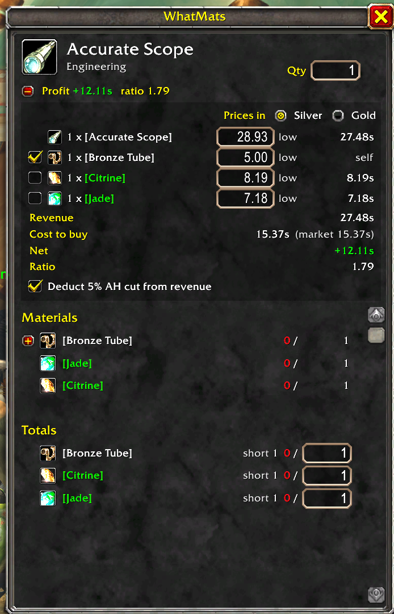
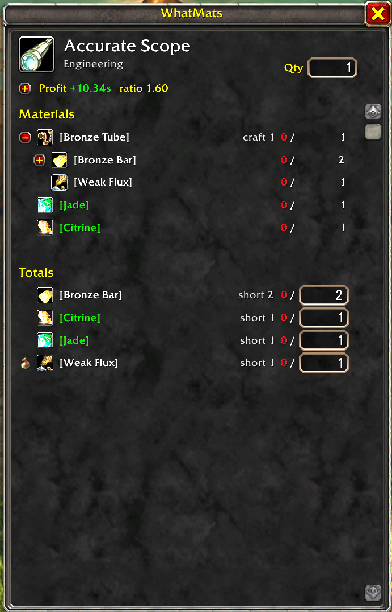
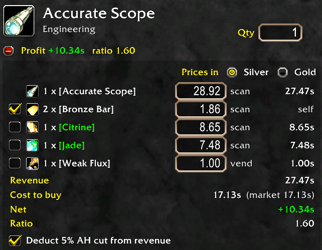

# WhatMats

**What do I need to make this?** WhatMats answers that.

Pick something you want to craft, tell it how many, and WhatMats breaks the recipe all the way down to the raw materials you need to gather or buy.

Download it from [CurseForge](https://www.curseforge.com/wow/addons/whatmats).

## Why

Many recipes need parts that are themselves crafted. That means a lot of tooltip hovering and math on paper. WhatMats does that work for you so you can see your full shopping list in one place.

## What it does

- **Breaks recipes down.** Shows every material a recipe needs, including the materials for any crafted parts.
- **Expands everything at once.** Click **Expand all** above the Materials list to break down every part your profession makes. Click **Reset** to go back.
- **Checks what you have.** Counts what's in your bags and bank, so you only see what you're still missing.
- **Gives you a shopping list.** The Totals list shows the base materials you still need to get.
- **Marks vendor items.** Materials you can buy from a vendor with gold get a small vendor icon. WhatMats learns these as you visit vendors.
- **Shows profit.** See what a craft costs, what it sells for, and whether it's worth making.
- **Opens from your profession window.** Click the WhatMats button next to a recipe, or shift-click an item or recipe to load it.
- **Searches the auction house for you.** Shift-click any item in the WhatMats window while the auction house is open to search for it.

## How to use it

1. Open each of your profession windows once so WhatMats can learn your recipes.
2. Open WhatMats from the minimap button, the button in your profession window, or by typing `/mats`.
3. Shift-click an item in your bags or a recipe in your profession window.
4. Set how many you want to make.
5. Check the Totals list to see what you still need.

## Checking profit

Click the **Profit** line under the recipe name to open the price breakdown. It shows:

- **Revenue:** what the crafted items sell for on the auction house, minus the 5% AH cut (you can turn the cut off).
- **Cost:** every material at its price, whether or not you already have it. A material you can craft counts at its own price unless you expand it in the Materials list. In brackets, what you'd spend on the materials you don't already have.
- **Net and ratio:** revenue minus cost, and how many times your cost you get back. A ratio of 1.0 means you break even. Neither changes as you craft and use up materials.

WhatMats picks up prices as you play:

- **Vendors:** what you paid the last time you bought from a vendor, or the vendor's price the last time you visited one. Items a vendor sells always use the vendor price.
- **Auction house:** what you paid the last time you bought on the AH, and the lowest price each time an item shows up in your AH searches.
- **Auctionator:** its scanned prices, if you have it installed. When your own AH searches have a price too, the newer one is used. WhatMats works fine without it.
- **You:** type a price into any box to set it yourself. Right-click the box to clear it.

A material with no price yet shows an orange **?**; hover it for how to get one. Prices are kept per character, since each one has its own reputation discounts and auction house.

Check the box next to a material you gather or make yourself to leave it out of the cost. Pick silver or gold at the top of the panel to choose how prices are shown and typed.

## Commands

| Command | What it does |
| --- | --- |
| `/mats` | Open or close the window |
| `/mats <recipe> [count]` | Print the breakdown in chat |
| `/mats scan` | Rescan the open profession window |
| `/mats list` | Show which professions have been scanned |
| `/mats resetvendors` | Forget the vendor items WhatMats has learned |
| `/mats help` | Show these commands |

## Preview

The Profit line shows what a craft makes at a glance.

Open it for the full breakdown, here using Auctionator prices.

