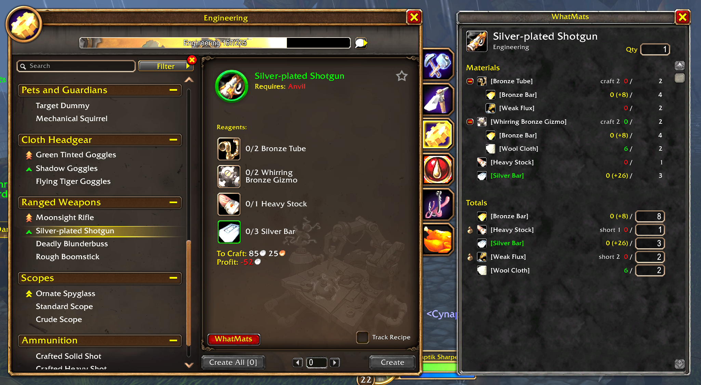

# WhatMats

**What do I need to make this?** WhatMats answers that.

Pick something you want to craft, tell it how many, and WhatMats breaks the recipe all the way down to the raw materials you need to gather or buy.

## Why

Many recipes need parts that are themselves crafted. That means a lot of tooltip hovering and math on paper. WhatMats does that work for you so you can see your full shopping list in one place.

## What it does

- **Breaks recipes down.** Shows every material a recipe needs, including the materials for any crafted parts.
- **Checks what you have.** Counts what's in your bags and bank, so you only see what you're still missing.
- **Gives you a shopping list.** The Totals list shows the base materials you still need to get.
- **Marks vendor items.** Materials you can buy from a vendor with gold get a small vendor icon. WhatMats learns these as you visit vendors.
- **Opens from your profession window.** Click the WhatMats button next to a recipe, or shift-click an item or recipe to load it.

## How to use it

1. Open each of your profession windows once so WhatMats can learn your recipes.
2. Open WhatMats from the minimap button, the button in your profession window, or by typing `/mats`.
3. Shift-click an item in your bags or a recipe in your profession window.
4. Set how many you want to make.
5. Check the Totals list to see what you still need.

## Commands

| Command | What it does |
| --- | --- |
| `/mats` | Open or close the window |
| `/mats <recipe> [count]` | Print the breakdown in chat |
| `/mats scan` | Rescan the open profession window |
| `/mats list` | Show which professions have been scanned |
| `/mats resetvendors` | Forget the vendor items WhatMats has learned |
| `/mats help` | Show these commands |

## Preview

